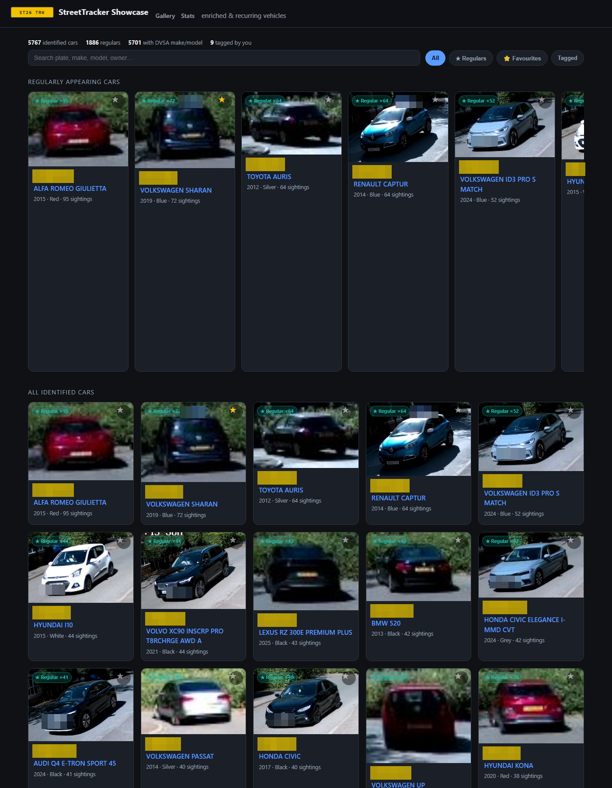
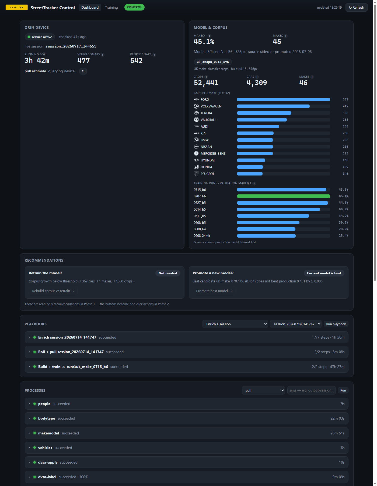
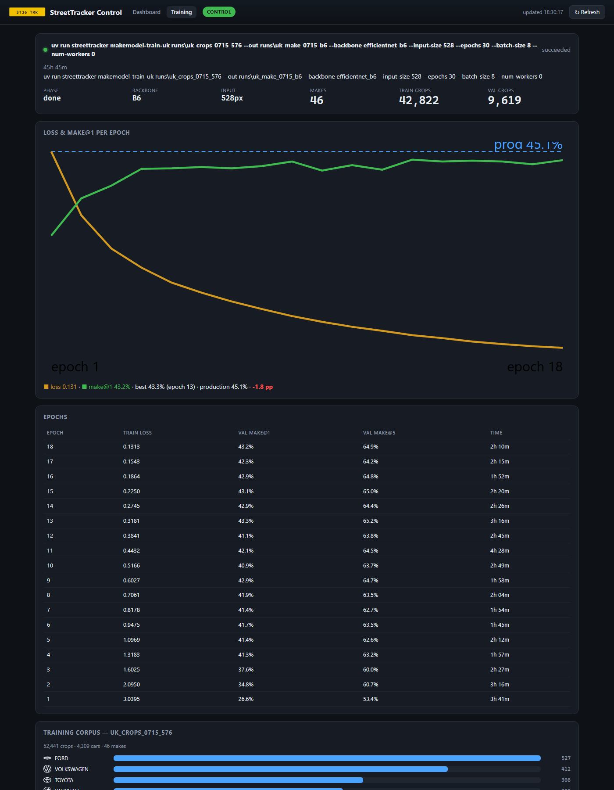
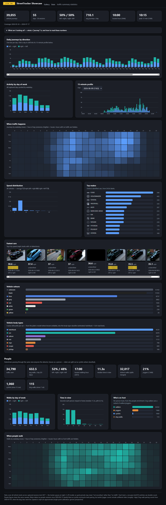

# StreetTracker 

Detect, track and describe the vehicles and people passing a street camera, then
enrich each pass with a number-plate read, the car's registered make, model and
colour, CNN predictions for the cars whose plates weren't read, and local web
pages to browse it all.

**Python 3.10 · Ultralytics YOLO + BotSORT · TensorRT · uv**

**Status:** in production. It has run live on a Jetson Orin Nano 8GB Super,
watching a residential street through a Reolink camera, since 2026-05-22. About
1,860 tests pass (2026-11-15).

```
Reolink RTSP sub-stream ─▶ YOLOv8m + BotSORT (TensorRT, Orin) ─▶ per-track attributes
                                         │                      (direction · speed · lane)
         4K stills on demand ◀── snap planner (traced road)       │
                 │                                                ▼
                 │                                     events log (JSONL, fsync)
                 ▼                                                │
   dev box: plate reading ─▶ DVSA make/model/year ─▶ per-vehicle records
            make · colour · body-type CNNs ─────────▶ showcase · /stats · control panel
```

## Hardware

| Role | Hardware | Software |
|---|---|---|
| Camera | Reolink RLC-1224A, 12 MP PoE turret | H.264 896×512 sub-stream for detection; 4512×2512 JPEG stills over HTTP |
| Device | Jetson Orin Nano 8GB Super, 1 TB NVMe | JetPack 6.2.2 · CUDA 12.6 · TensorRT 10.3 · systemd service |
| Dev box | Windows 11, RTX 3080 10 GB | plate reading, DVSA lookups, classifier training, the web apps |

The device pipeline also runs on a dev box against video files (`streettracker batch`).
TensorRT engines are tied to the GPU they were built on, so build them on the
target device.

## Features

- **Detection and tracking.** YOLOv8m with BotSORT through Ultralytics, from a
  TensorRT engine on the Orin. It tracks cars, vans, buses, motorbikes, bicycles,
  people and dogs. A track's class is a confidence-weighted vote, so one bad
  frame can't relabel it.
- **Per-track attributes.** Direction, speed, lane, where the track entered and
  left the frame, and a flag for "people" whose box is car-shaped.
- **4K capture.** An operator-traced road polygon, trigger lines and repeated
  in-band fires request 4K stills from the camera while each car is in the best
  stretch of road. About 98 % of cars get at least one still.
- **Plate reading** (offline). Each still is searched for the vehicle that
  matches the track's path, and its plate is read. Parked and background plates
  are filtered out, and reads whose plate colour contradicts the direction of
  travel (white front, yellow rear) are dropped. A shared plate gate decides
  which reads are trusted.
- **Make, model and colour.** Trusted plates are looked up in the DVSA MOT
  History API. Three EfficientNet classifiers, trained on this street's own
  DVSA-labelled cars, predict make, colour and body type for the rest. A
  vehicle stopped in the road is kept out of the crops of the cars passing it.
- **Per-vehicle records.** Tracks and plate reads fold into one record per car,
  within a session and across sessions, with fuzzy matching of one-character
  OCR variants.
- **People.** Walkers, joggers and cyclists, dog walkers, and walks that the
  tracker split into several tracks merged back together. Walks are never
  matched across days.
- **Web apps.** A live summary page on the device, a showcase of the identified
  cars with traffic, people and schedule statistics, and an operator control
  panel that runs the whole pull → enrich → train → promote loop.

## Quick start: dev box

```bash
uv sync --extra alpr --extra dev                         # extras aren't additive: name every one you need
cp configs/camera.example.json configs/camera.json       # edit to suit
uv run streettracker batch path/to/video.mp4 --config configs/camera.json
```

## Quick start: Orin Nano

```bash
scripts/setup_orin.sh                                    # idempotent: apt deps, uv, venv, TensorRT symlinks
uv run streettracker export-engine yolov8m.pt            # builds the engine for this GPU
cp configs/camera.example.json configs/camera.json       # camera address and credentials, road polygon, snap gate
uv run streettracker run --config configs/camera.json
```

The service unit, backups, recovery and the JetPack 7 plan are in
[`docs/deployment.md`](docs/deployment.md#fresh-deployment-procedure). On a
deployed Orin, check the Jetson wheel index before running a bare `uv sync`; the
service runs with `--no-sync` for that reason.

## CLI

`streettracker --help` lists every command; `streettracker <command> --help`
gives its options.

| Stage | Commands |
|---|---|
| Capture | `run` (live, Orin) · `batch` (video file) · `export-engine` · `pull` (copy a session off the Orin) · `recover-session` (rebuild a session the device never finalised) |
| Plates (`--extra alpr`) | `alpr-run` · `alpr-rescore` · `alpr-colour` · `alpr-score` · `alpr-label` · `alpr-report` |
| Labels and records | `dvsa-label` (needs `configs/dvsa.json`) · `dvsa-apply` · `vehicles` · `people` |
| Classifiers | `makemodel` · `bodytype` · `colour` (each takes `--only-changed`) · `makemodel-build-uk` · `makemodel-train-uk` · `makemodel-compare` · `model-release` |
| Web | `showcase` (http://127.0.0.1:8090/) · `control` (http://localhost:8095/) |
| Legacy | `recolor` · `debug-color` (the HSV colour vote) · `makemodel-train` (CompCars) |

## Web interfaces

| UI | Host | Command | URL |
|---|---|---|---|
| **Live summary** | Orin | served by `streettracker run` | `http://<orin>:8080/` |
| **Showcase** | dev box | `uv run streettracker showcase --output-root output` | `http://127.0.0.1:8090/` |
| **Control panel** | dev box | `uv run streettracker control --output-root output` | `http://localhost:8095/` |

- **Live summary.** The capture service regenerates a page for the current
  session (track tiles, hourly rollup) whenever the street goes quiet.
- **Showcase.** A gallery of the plate-identified cars across every session,
  with DVSA details, every sighting, behavioural badges (resident, visitor and
  so on), and a per-car editor for names and notes. `/stats` covers every car
  track, read or not: journeys by day and hour, speeds, makes, colours and body
  types. `/people` and `/schedule` cover pedestrians and recurring arrival
  times. It binds `127.0.0.1` by default because its pages show plates; pass
  `--host 0.0.0.0` for the LAN.
- **Control panel.** Runs the day-to-day procedures without anyone at a
  terminal: pulls, enrichment, corpus builds, training, head-to-head model
  comparisons and promotion. It shows the device's status, the session
  inventory and retrain/promote recommendations, and runs multi-step playbooks
  (enrich, build-train, roll, promote, reinfer, guard, rescore, relabel,
  platecheck) with progress bars and a live training curve. A failed step
  offers a ready-made help prompt. The pages are viewable on the LAN; every
  action is localhost-only. Detached launcher:

  ```powershell
  pwsh -NoProfile -File scripts/control_panel.ps1
  ```

Full reference: [`docs/sites.md`](docs/sites.md).

### Screenshots

| Showcase: identified and recurring cars | Control panel: operator dashboard | Control panel: live training |
|---|---|---|
| [](docs/assets/screenshot_showcase.png) | [](docs/assets/screenshot_control.png) | [](docs/assets/screenshot_training.png) |

| Showcase: `/stats` traffic analytics |
|---|
| [](docs/assets/stats.png) |

*Number plates and owner tags are pixelated for publication.*

## Results on this street

One oblique camera over a residential street. The plate figures count reads of
a valid UK plate shape. Only the plate-colour rule checks that a read plate
belongs to the tracked car, so these are read rates, not verified reads.

- **4K coverage.** About 98 % of cars and two thirds of people get at least one still.
- **Plates.** 68.3 % of cars get a read (R→L 69.7 %, L→R 66.8 %; 2026-07-28).
  Daylight reaches about 75 %; dusk and dark about 45 %, where motion blur
  smears plates the detector still finds.
- **DVSA labels.** 41.8 % of car journeys carry the register's make, model and
  colour (2026-10-04).
- **Classifiers**, per track on cars no model was trained on (2026-10):

  | Head | Model | Accuracy |
  |---|---|---|
  | Make (62 makes) | EfficientNet-B6 @528 | 85.0 % (117 cars) |
  | Colour (11) | EfficientNet-B0 @384 | 83.3 % (118 cars) |
  | Body type (7) | EfficientNet-B0 @384 | 89.1 % (109 cars) |

  They were trained on 76,033 plate-anchored crops of 4,347 DVSA-labelled cars.
  These scores are on plated cars; accuracy on the unplated majority, where the
  crop comes from the car's path instead of its plate, hasn't been measured.

## Output

Each finalised track saves a dashboard tile (`{prefix}_{id}.jpg`), an HQ
sub-stream crop (`_hq.jpg`) and its 4K stills (`_main_{N}.jpg`), where
`{prefix}` is `vehicle` or `person`. Each session holds `_events.jsonl` (written
as tracks end, so it survives a crash), `_trajectories.jsonl`, `_data.json`,
`_meta.json`, `_hourly.json` and the summary page. The dev-box steps add their
own files beside them: plate reads, DVSA labels, per-vehicle records,
classifier predictions and people. Every file is described in
[`docs/session_files.md`](docs/session_files.md); record fields are in
`common/schema.py`.

## Project layout

```
src/streettracker/
├── common/      # schema, strict JSON config, session file paths, atomic writes, summary page
├── inference/   # YOLO + BotSORT via Ultralytics / TensorRT
├── sources/     # RTSP (FFmpeg over TCP) and file input (NVDEC on the Orin)
├── device/      # Orin only: live runtime, snap planner, snapshotter, dashboard, IR detector
├── analysis/    # dev box: plate reading, DVSA, vehicles, people, classifiers, vehicle locator
├── web/         # showcase site: gallery, stats, people, schedule
├── control/     # operator control panel: jobs, playbooks, progress parsing
└── cli/         # `streettracker` entry point; every subcommand is one line in cli/commands.py
```

## Development

```bash
uv run pytest                        # tests (tests marked `device` need a Jetson)
uv run ruff check src/ tests/        # lint
uv run ruff format src/ tests/       # format
uv run mypy src/                     # type-check
```

CI runs the tests in two jobs (one without torch, one with CPU torch for the
classifier tests) and enforces `ruff check`, `ruff format --check`, `mypy` and a
complexity limit. The runtime is asyncio throughout, and the config loader
rejects unknown keys.

**Docs.** [`CLAUDE.md`](CLAUDE.md) holds the current state and the standing
rules; [`docs/`](docs/) holds the rest:
[deployment](docs/deployment.md), [the snap gate](docs/snap_gate.md),
[session files](docs/session_files.md), [the web apps](docs/sites.md), the
[data-integrity review](docs/data_integrity_review.md), the
[architecture map](docs/architecture/) and the dated
[history](docs/history/README.md) of every tuning result.

## Roadmap

1. **Data integrity.** A hand-checked audit set of plate reads, to calibrate
   the plate gate and the plate-colour check against reads known to belong to
   the tracked car. The plan is in
   [`docs/data_integrity_review.md`](docs/data_integrity_review.md).
2. **Low-light plates.** A faster shutter scheduled for the dusk and dawn rush
   hours, where motion blur costs the most reads.
3. **JetPack 7.2** (CUDA 13.2, TensorRT 10.16, Python 3.12, Ubuntu 24.04). It
   waits for Orin (`sm_87`) PyTorch wheels on the jetson-ai-lab index. Check
   from the dev box:

   ```powershell
   pwsh -ExecutionPolicy Bypass -File scripts/check_jp7_wheel.ps1   # exit 0 = ready, 1 = not yet
   ```

   The repo edits and the flash plan are in
   [`docs/deployment.md`](docs/deployment.md#jetpack-7-upgrade-plan).

## License

MIT.
